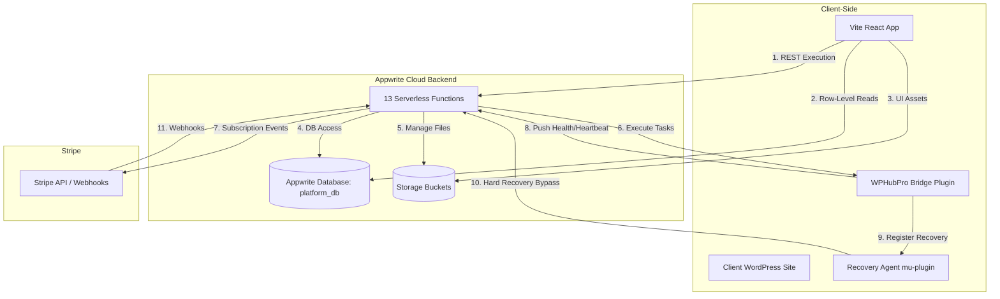

# WP Hub Pro — Project Canvas

This canvas provides a comprehensive, high-level blueprint of the **WP Hub Pro** platform ecosystem. It acts as the single source of truth mapping out the architecture, codebase structures, database schemas, and integration flows between the two primary repositories: the **`wphub-pro`** monorepo and the **`wphubpro-bridge`** WordPress plugin.

---

## 1. System Architecture

The WP Hub Pro ecosystem consists of a **Vite React Platform Frontend**, a **Serverless Appwrite Backend**, and a **WordPress Bridge Plugin** that runs directly on clients' WordPress installations to enable remote site management.



---

## 2. Workspace & Codebase Layouts

### A. Monorepo: `wphub-pro`
**Repository Root:** `/Volumes/Code045Disk/Applications/wphub-pro/`  
**Primary Configuration File:** [appwrite.config.json](file:///Volumes/Code045Disk/Applications/wphub-pro/appwrite.config.json)

| Path | Description / Role | Primary Docs |
|:---|:---|:---|
| [appwrite.config.json](file:///Volumes/Code045Disk/Applications/wphub-pro/appwrite.config.json) | The Appwrite CLI schema definitions for all database tables, buckets, functions, and site metadata. | [AGENTS.md](file:///Volumes/Code045Disk/Applications/wphub-pro/.cursor/docs/AGENTS.md) |
| [functions/](file:///Volumes/Code045Disk/Applications/wphub-pro/functions) | The 13 serverless Node.js 22 + TypeScript Appwrite functions. | [FUNCTIONS.md](file:///Volumes/Code045Disk/Applications/wphub-pro/.cursor/docs/FUNCTIONS.md) |
| [functions/shared/](file:///Volumes/Code045Disk/Applications/wphub-pro/functions/shared) | The `@code045/wphubpro-shared` npm package. Shared utility logic. | [SHARED.md](file:///Volumes/Code045Disk/Applications/wphub-pro/.cursor/docs/SHARED.md) |
| [sites/wphubpro/](file:///Volumes/Code045Disk/Applications/wphub-pro/sites/wphubpro) | The React 19 + TypeScript frontend application built on Vite and React Router 7. | [WORKSPACE.md](file:///Volumes/Code045Disk/Applications/wphub-pro/.cursor/docs/WORKSPACE.md) |
| [workers/](file:///Volumes/Code045Disk/Applications/wphub-pro/workers) | Cloudflare Workers (e.g., `appwrite-github-dispatch` for webhooks). | [WORKSPACE.md](file:///Volumes/Code045Disk/Applications/wphub-pro/.cursor/docs/WORKSPACE.md) |
| [.cursor/](file:///Volumes/Code045Disk/Applications/wphub-pro/.cursor) | Contains agent rules (`.cursor/rules/`), docs (`.cursor/docs/`), and scripts (`.cursor/scripts/`). | [AGENTS.md](file:///Volumes/Code045Disk/Applications/wphub-pro/AGENTS.md) |

### B. WordPress Plugin: `wphubpro-bridge`
**Repository Root:** `/Volumes/Code045Disk/Applications/wphubpro-bridge/`  
**Main Plugin Entry:** [wphubpro-bridge.php](file:///Volumes/Code045Disk/Applications/wphubpro-bridge/wphubpro-bridge.php)

| Path | Description / Role |
|:---|:---|
| [wphubpro-bridge.php](file:///Volumes/Code045Disk/Applications/wphubpro-bridge/wphubpro-bridge.php) | Plugin bootstrap file. Manages autoloader initialization, activation (Recovery Agent placement), and deactivation. |
| [includes/Bridge.php](file:///Volumes/Code045Disk/Applications/wphubpro-bridge/includes/Bridge.php) | Orchestrator registering all `wphubpro/v1` REST API routes and features. |
| [includes/Admin/](file:///Volumes/Code045Disk/Applications/wphubpro-bridge/includes/Admin) | Admin interface and connection status templates. |
| [includes/Api/](file:///Volumes/Code045Disk/Applications/wphubpro-bridge/includes/Api) | REST API endpoints for Health snapshot pushing (`Health.php`), updater functions, and action invoking. |
| [includes/Cron/](file:///Volumes/Code045Disk/Applications/wphubpro-bridge/includes/Cron) | Native WP pseudo-cron schedules for Heartbeat checkins and Health checks. |
| [includes/Plugin/](file:///Volumes/Code045Disk/Applications/wphubpro-bridge/includes/Plugin) | Plugin operations (install, update, query statuses). |
| [includes/Theme/](file:///Volumes/Code045Disk/Applications/wphubpro-bridge/includes/Theme) | Theme operations (install, update, query statuses). |
| [recovery/](file:///Volumes/Code045Disk/Applications/wphubpro-bridge/recovery) | The hard recovery agent file copied to WP's `mu-plugins/` directory on activation or update. |

---

## 3. Database Schema & Storage

The system database is named **`platform_db`** (Database ID: `platform_db`). Canonical IDs are configured in [ids.ts](file:///Volumes/Code045Disk/Applications/wphub-pro/functions/shared/src/appwrite/ids.ts).

### A. Collections (Tables)
1. **`library`**: Stores items in the system WordPress package repository.
2. **`sites`**: Details on user WordPress installations connected to the hub.
3. **`library_families`**: Grouping criteria for library items.
4. **`library_collections`**: Structured packages/bundles of themes/plugins.
5. **`tickets`**: Customer support issues.
6. **`platform_settings`**: Global site settings and feature toggles.
7. **`ticket_messages`**: Conversations inside support tickets.
8. **`accounts`**: User login profiles and permissions details.
9. **`ticket_activities`**: Timestamps and audits for tickets.
10. **`library_categories`**: Core taxonomic categories for plugins/themes.
11. **`bridge`**: Releases, metadata, and security parameters of the WPHubPro Bridge plugin.
12. **`notifications`**: User/workspace notification logs.
13. **`teams`**: Workspace and billing details.
14. **`team_invites`**: Team invite emails, tokens, and active/expired states.
15. **`system_email_templates`**: Rich templates for platform-triggered emails.
16. **`system_email_shell`**: Shell designs wrapped around email notifications.
17. **`platform_events`**: Audit trail of administrative actions.
18. **`test`**: Testing and development verification collections.

### B. Storage Buckets
- **`bridge`** (`bridge`): Stores Bridge plugin release ZIP files.
- **`avatars`** (`avatars`): User profile and team avatars.
- **`media_library`** (`media_library`): Media assets.
- **`plugins`** (`plugins`): WordPress plugin ZIP packages uploaded to the Library.
- **`themes`** (`themes`): WordPress theme ZIP packages uploaded to the Library.
- **`dev`** (`6a0e670d00380379a6d4`): General development bucket.

---

## 4. Appwrite Serverless Functions

The platform coordinates **13 serverless functions** running on **Node.js 22** via custom TypeScript codebases. The entrypoint for each is `main.ts` (compiled to `dist/main.js`).

| Function `$id` | Timeout (s) | Purpose | UI Domain Match |
|:---|:---:|:---|:---|
| **`bridge`** | 120 | Handles Bridge downloads, validation, and release metadata updates. | `bridge`, `wp-proxy` |
| **`library`** | 60 | Handles Library indexing, category sorting, and install packages. | `library`, `wp-install` |
| **`messaging`** | 60 | Dispatches system notifications, parses email templates, and sends emails. | `notifications`, `system-email` |
| **`platform-settings`**| 90 | Manages configuration updates, global platform switches. | `platform`, `platform-events` |
| **`recovery-manager`** | 60 | Executes hard bypass operations via the `mu-plugin` Recovery Agent. | `admin` |
| **`sites`** | 300 | Orchestrates site health diagnostics and reports updates. | `sites` |
| **`stripe-api`** | 120 | Orchestrates billing, portals, checkouts, and handles incoming webhooks. | `billing` |
| **`support`** | 30 | Handles ticketing workflows, agent reassignment, and status changes. | `tickets` |
| **`uptime-robot`** | 120 | Monitors site availability, pinging sites and logging incidents. | `uptime` |
| **`user-mailbox`** | 120 | Interfaces with IMAP mailboxes, pulling incoming admin/support emails. | `mailbox` |
| **`users`** | 120 | Administers users, memberships, team roles, and profile settings. | `teams`, `users`, `workspace` |
| **`wp-proxy`** | 120 | Proxies ZIP installations, themes, and plugin status edits to site APIs. | `library`, `bridge` |
| **`github-config-sync`**| 15 | Syncs `appwrite.config.json` configurations upon schema change events. | None (Auto Event) |

---

## 5. Front-End Architecture (`sites/wphubpro`)

Built using **React 19**, **TypeScript**, **Vite**, and styled with **Vanilla CSS & Bootstrap SCSS**.

### Architecture: Domain-Driven Modular Layout
The front-end code is organized inside **17 distinct app domains** under `src/domains/<domain>/`:

> **App Domains:** `admin`, `auth`, `billing`, `bridge`, `docs`, `library`, `mailbox`, `notification-templates`, `notifications`, `platform`, `platform-events`, `profile`, `sites`, `system-email`, `teams`, `tickets`, `workspace`.

Each domain enforces the following standard file roles:
- **`types.ts`**: Holds domain-specific interfaces, DTOs, and Document typings.
- **`api.ts`**: Contains RPC methods interacting with Appwrite serverless functions via `executeFunction.ts`.
- **`queries.ts`**: Contains client-side row-level Appwrite database queries.
- **`mappers.ts`**: Converts Appwrite Database documents to optimized React view models.
- **`queryKeys.ts`**: React Query key factory declarations to keep caches clean.
- **`hooks.ts` / `hooks/`**: Houses all custom React Query `useQuery` and `useMutation` hooks.

> [!IMPORTANT]
> **View-only restriction:** Front-end JSX views must **never** perform direct, raw Appwrite database queries. They are restricted to consuming variables and actions exposed by custom hooks within the domain directories (`import from "@/domains/<domain>"`).

---

## 6. Bridge Integration Workflows

The platform commands WordPress sites via the **WPHubPro Bridge** REST namespace (`wphubpro/v1`). Authentication is established via high-entropy API keys or JSON Web Tokens (JWT).

```
                  ┌──────────────────────┐
                  │ WPHub Pro Dashboard  │
                  └──────────┬───────────┘
                             │ (REST Action)
                             ▼
                  ┌──────────────────────┐
                  │ Appwrite: wp-proxy   │
                  └──────────┬───────────┘
                             │ (POST API Key Auth)
                             ▼
                  ┌──────────────────────┐
                  │ WordPress REST API   │
                  │   (/wphubpro/v1)     │
                  └──────────┬───────────┘
                             │
            ┌────────────────┴────────────────┐
            ▼                                 ▼
    ┌───────────────┐                 ┌───────────────┐
    │  Plugins/     │                 │   Site        │
    │  Themes APIs  │                 │   Health/Logs │
    └───────────────┘                 └───────────────┘
```

### Key Functional Endpoints & Capabilities
1. **Handshake & Verification (`/connection-status` & `/connect`)**: Confirms communications and authenticates keys.
2. **Uptime & Diagnostics (`/heartbeat` & `/health/push`)**: Custom WP cron tasks periodically trigger heartbeats and push comprehensive health audits back to Appwrite.
3. **Software Updates (`/updater` & `/plugins` & `/themes`)**: Initiates remote plugins and themes installs directly via proxy links or ZIP buffers.
4. **Resiliency Bypass (Recovery Agent)**:
   - Placed as a Must-Use plugin (`mu-plugins/wphubpro-recovery-agent.php`).
   - If a WordPress site encounters a critical error ("White Screen of Death"), the main bridge plugin might crash. The standalone recovery agent interceptor bypasses normal WP boot cycles, allowing `recovery-manager` to deactivate the faulty theme or plugin.

---

## 7. Operational & Development Policies

> [!WARNING]
> **Rule 1 — No automatic installs or builds:** Never execute commands that run package installations or build triggers globally without explicit permission.
>
> **Rule 2 — Appwrite settings changes require config updates:** When configuring tables, buckets, or functions in Appwrite, you **must** update [appwrite.config.json](file:///Volumes/Code045Disk/Applications/wphub-pro/appwrite.config.json).
>
> **Rule 3 — Shared code changes require version syncing:** Do not reference folders in `functions/shared/` using relative paths. All functions must rely on the npm-packaged `@code045/wphubpro-shared`. Updates must be compiled, published, and version pins bumped in the target functions' `package.json` configurations.

### Key Deployment Commands

**Settings Push (No Code)**
```bash
appwrite push functions --all --no-code
```

**Full Backend Deploy**
```bash
appwrite push functions
appwrite push tables
```

**Sync Settings From Console**
```bash
node .cursor/scripts/sync-appwrite-config-from-cloud.js
```
